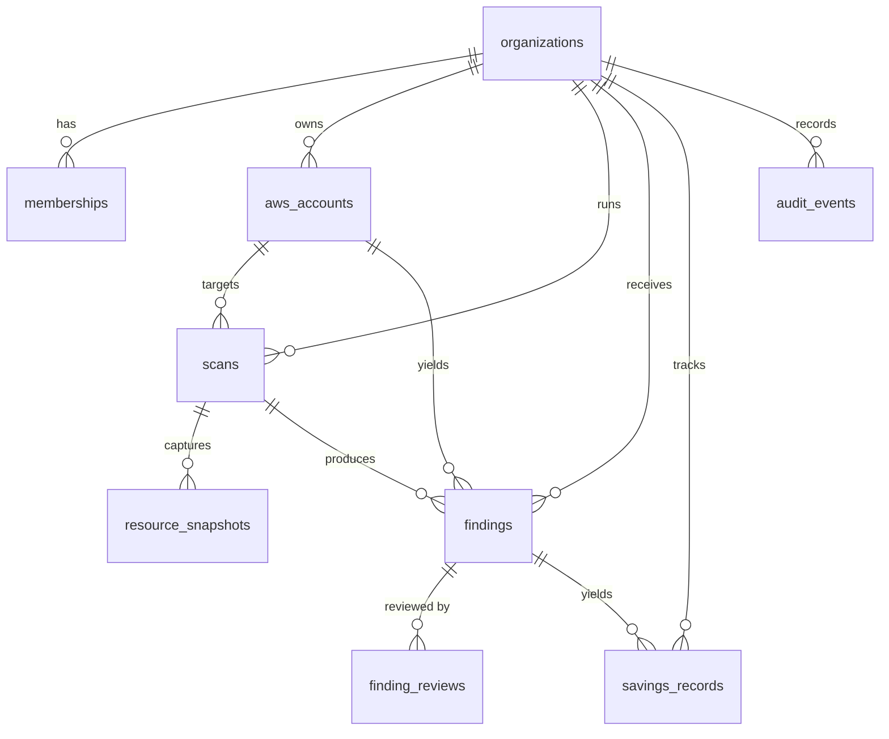

# Architecture

## What CloudPatrol is

CloudPatrol reads an AWS account through a customer-created, read-only role and
reports idle or under-used resources. It produces findings with the evidence
behind them, and it keeps estimated savings separate from verified savings.

The read-only constraint is structural, not a setting. There is no code path in
the application that creates, modifies or deletes an AWS resource, and the IAM
policy it asks customers to attach grants no permission to do so.

## Services

| Service | Path | Stack |
| --- | --- | --- |
| API | `services/api` | Python 3.13, FastAPI, Pydantic v2, boto3 |
| Web | `apps/web` | Next.js (App Router), React, TypeScript, Tailwind CSS v4 |
| Database | `supabase/migrations` | PostgreSQL (Supabase), Row Level Security |

## Request flow

```mermaid
flowchart LR
    Browser["Browser<br/>Next.js dashboard"]
    Auth["Supabase Auth"]
    Proxy["BFF proxy<br/>/api/proxy/*"]
    Cookie[("HttpOnly session cookie")]
    API["FastAPI service"]
    Verifier["Token verifier<br/>Supabase JWT"]
    Authz["Organization context<br/>membership check"]
    Scan["Scan service"]
    Adapter["AWS adapter<br/>boto3"]
    STS["AWS STS<br/>AssumeRole"]
    AWS["AWS read-only APIs<br/>EC2, CloudWatch, CE"]
    DB[("PostgreSQL<br/>RLS enforced")]

    Browser -->|"email + password"| Auth
    Auth -->|"session cookie (HttpOnly)"| Cookie
    Browser -->|"same-origin fetch"| Proxy
    Cookie --> Proxy
    Proxy -->|"Bearer token, attached server-side"| API
    API --> Verifier
    Verifier --> Authz
    Authz --> Scan
    Authz --> DB
    Scan --> Adapter
    Adapter --> STS
    STS -->|"temporary credentials"| Adapter
    Adapter --> AWS
    Scan --> DB
```

The browser never talks to AWS, never holds AWS credentials, and never holds the
Supabase access token: the token lives only in an HttpOnly cookie and is turned
into an `Authorization` header by the BFF proxy on the server. The token
verifier establishes *who* is calling; the organization context establishes
*what they may see*.

## Layers

### 1. Presentation

`apps/web`. Pages are client components that read the active workspace from a
`useSyncExternalStore` store (`lib/session.ts`) and fetch through the API client
in `apps/web/lib/api.ts`, which calls same-origin `/api/proxy/*` and never holds
a credential. `lib/use-async.ts` gives every page the same four states —
loading, error, empty, loaded — so a failed request renders as a failure rather
than as an empty list.

Sign-in is at `/sign-in` and runs through a server action
(`lib/auth/actions.ts`). The session gate (`components/RequireSession.tsx`)
renders the signed-in state from the identity the server layout resolved, so a
user never sees a sign-in flash they do not need.

The UI states its own uncertainty explicitly:

- A scan whose partial-failure list is non-empty is labelled "Completed with
  gaps" and explains that absent findings are not proof of absent waste
  (`components/ScanRow.tsx`).
- A finding with a null estimate shows "Not priced" rather than `$0.00`
  (`lib/format.ts`). Those are different statements.
- Every figure is fetched from the API for the active workspace. A request that
  fails is shown as a failure (`components/ui.tsx` `ErrorState`), never as an
  empty result, so a broken connection cannot read as a clean account.
- A `401` from the API flips the session to signed-out and says the session
  ended, rather than rendering an empty dashboard that looks like a clean
  account.

### 2. Identity and organization authorization

`lib/supabase/server.ts` owns the session. `@supabase/ssr` writes it to an
HttpOnly cookie; the app never parses or stores a token itself. `proxy.ts`
refreshes the session on each page request and guards the protected routes.
`app/api/proxy/[...path]/route.ts` is the only place a token is turned into a
header.

`app/core/security.py` verifies Supabase-issued JWTs. HS256 tokens are checked
against the shared secret; RS256/ES256 tokens are checked against the project's
JWKS endpoint. Any other algorithm — including `none` — is refused, which is
what prevents a forged-token bypass. `exp`, `sub`, `aud` and `iss` are required,
and the issuer is pinned to the configured project when `SUPABASE_URL` is set.

`app/core/dependencies.py` resolves the caller's membership in the requested
organization. The caller cannot assert an organization; it must be a member.

### 3. API and application services

`app/api/`. Routers are thin: they validate input, delegate, and shape output.
Business logic lives in `app/services/`.

### 4. Scan orchestration

`app/services/scan_service.py` performs one scan: list resources per region,
read metrics, run the detectors, and write findings. Failures are collected per
service and region into `partial_failures` rather than aborting the scan, so a
permission gap in one region does not discard results from the others. Repeated
identical failures are collapsed into one entry with an occurrence count, so a
missing CloudWatch permission across 300 instances reads as one fact.

`app/services/scan_runner.py` runs scans off the request path:

- `ScanExecutor` performs one queued scan. It resolves credentials from the
  vault itself, so no temporary credential is queued. Every failure path ends
  in a terminal scan state; an unhandled error is recorded and re-raised rather
  than leaving the scan stuck.
- `ScanWorkerPool` is a bounded queue served by a fixed number of threads. The
  bound is deliberate: an unbounded queue turns a request burst into unbounded
  memory growth, so a full queue is refused. Threads suit the synchronous AWS
  SDK, and a scan is dominated by network waits.
- `StaleScanReaper` fails scans abandoned by a dead worker. Without it a
  crashed scan would hold `running` forever and block that account from ever
  being scanned again. The staleness check and the write happen under the store
  lock, so a scan claimed by a worker in the meantime is not failed.

`POST /api/v1/scans` therefore returns `202 Accepted` with the queued scan, and
the client polls `GET /api/v1/scans/{id}`. The role is assumed before the scan
row is created: a failed assumption must not leave a `queued` row that counts
as active and blocks the account.

### 5. AWS integration adapters

`app/aws/adapter.py` defines an `AwsAdapter` protocol; `app/aws/boto3_adapter.py`
implements it. Keeping the protocol separate is what lets the test suite run
the entire application against `tests/fake_aws.py` with no network access, so
no test can reach a live AWS account.

Every call is bounded by a connect timeout, a read timeout, and a retry budget
for throttling only. Throttling is retried with exponential backoff; a
permission error is not retried, because retrying it cannot help.

`sts:AssumeRole` is translated separately from a read call
(`translate_assume_role_error`). An `AccessDenied` on `AssumeRole` is a trust
policy or external ID problem rather than a data-permission problem, and AWS
reports both with the same code, so the distinction is made where the AWS
message is still available. The AWS message is never forwarded to the client:
it echoes the role ARN and the external ID it received.

`POST /api/v1/aws/accounts/{id}/validate` performs a real `AssumeRole` followed
by `GetCallerIdentity` using the external ID from the vault. It reports the
resulting session expiry, and a failure marks the stored connection `failed`
rather than leaving it claiming to be `validated`. The external ID is never
returned.

**Regions are constrained by `aws_allowed_regions`.** The list is enforced when
an account is connected, not merely documented: a region outside it is rejected
before any AWS call is made. A scan makes outbound calls per configured region,
so an unbounded list is both a cost and an operational risk.

### 6. Data ingestion and normalization

Resources are normalized into `ResourceSnapshotRecord` before detectors run.
Detectors therefore work from a consistent shape regardless of which AWS API
produced the data.

### 7. Detection and savings

`app/services/detectors/`. Three detectors are implemented:

| Detector | Signal | Priced? |
| --- | --- | --- |
| `unattached_ebs_volume` | Volume state `available` | Yes — size × per-GiB-month |
| `unassociated_elastic_ip` | Allocated address with no association | Yes — hourly × 730 |
| `low_utilisation_ec2` | Average CPU below threshold over a window | No — see below |

The EC2 detector deliberately reports no figure. Downsizing to an unknown
target cannot be priced, and inventing a number would be worse than reporting
none. `estimated_monthly_savings` is therefore nullable, and null is
distinguished from zero at every layer, including the database
(`numeric(14,2)` with no default and no `not null`).

Reported spend is read from Cost Explorer grouped by service, with
pagination followed to the last page. A "total" is only reported within one
currency and one billing period: summing several months would produce a figure
matching no invoice, so the latest period is the one totalled and observations
outside it are excluded. If a single period contains more than one currency the
total is withheld and the rows are still returned.

Pricing comes from a built-in price book (`app/services/pricing.py`). The
values in it are **placeholders for us-east-1 on-demand rates**, not a live AWS
price feed, and the source string says so. The capture date is recorded in each
finding's evidence. The price book is isolated behind `PriceBook` precisely so
a real source — the AWS Price List API, or a curated table — can replace it
without touching detector logic.

### 8. Decision engine

Findings carry a state machine — `estimated`, `acknowledged`, `implemented`,
`verified`, `dismissed`. Reviewing a finding is not an infrastructure change,
so members may triage.

### 9. Database, audit and reporting

`supabase/migrations/0001_init.sql`. Two points of note:

- **Money is `numeric(14,2)`, never a float.** These values are summed and
  shown as currency; binary floating point cannot represent `0.10` exactly.
- **Verified savings cannot exist without evidence.** A check constraint
  requires `evidence` and a measurement window whenever `basis = 'verified'`.
  A row claiming verified savings with nothing behind it is rejected by the
  database, not merely discouraged in code.

### 10. Remediation

Not implemented, and not planned for this phase. It is deliberately absent
rather than stubbed: a half-built write path into a customer's cloud account is
the most dangerous thing this product could contain.

## Data model

Every tenant-owned table carries `organization_id` and has RLS enabled.

## Verification status

The API test suite passes with outbound sockets blocked, which demonstrates
that no test reaches live AWS. See `docs/SECURITY.md` for the RLS test results
and `docs/DEVELOPMENT.md` for how to run everything.
